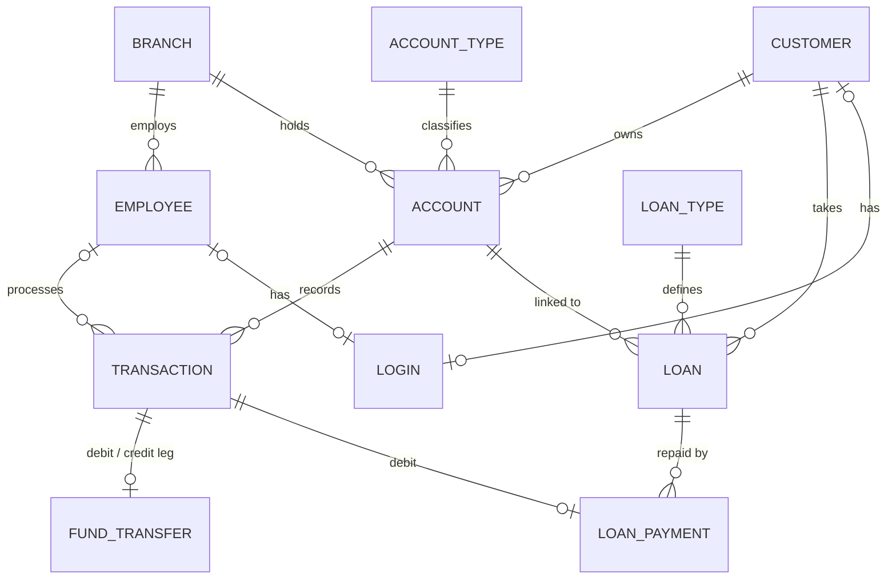

# Banking Transaction & Account Management System

A DBMS course project that models core banking operations in **PostgreSQL**. The business rules (balances, limits, loan states, audit logging) live **inside the database** as constraints, triggers and stored procedures, so no client can bypass them. A small FastAPI backend and HTML/JS portal sit on top as a thin demo layer.

> **Academic prototype.** All data is synthetic (fictional bank prefix `DUMY`). Do not use with real banking data.

**Team:** Moyukh Mondal (252123017) · Koushik Maity (252123014) · Rajeev Lalawat (252123022)
Slides: [`dbms_project_final.pptx`](dbms_project_final.pptx)

---

## Highlights

- **Rules enforced in SQL.** Balance checks, transaction limits, minimum balance, loan state changes and auditing are done by triggers and procedures.
- **One `TRANSACTION` table** for every money movement (deposit, withdrawal, transfer leg, loan payment).
- **Balances are never edited directly.** A trigger updates `Current_Balance` from each inserted transaction; a direct `UPDATE` is rejected.
- **Immutable history.** Transactions cannot be updated or deleted.
- **Atomic transfers.** Debit, credit and the `FUND_TRANSFER` header are written in one procedure call; any failure rolls back everything. Accounts are locked in sorted order to avoid deadlocks.
- **Audit trail.** Changes to the main tables are logged to `AUDIT_LOG` as JSONB (password hashes removed).

---

## Repository layout

```
sql/
├── tables.sql                 # Schema, constraints, indexes
├── triggers.sql               # Validation, balance, loan and audit triggers
├── stored_procedures.sql      # Banking operations
├── dummy_data_generation.sql  # Synthetic seed data
└── checks.sql                 # Integrity checks (every count should be 0)
backend/                       # FastAPI app (calls the stored procedures)
frontend/                      # Static HTML/CSS/JS portal
dbms_project_final.pptx        # Project presentation
```

---

## Database design

**12 tables:** 11 business tables plus `AUDIT_LOG`.



| Table | Purpose | Key rules |
|---|---|---|
| `BRANCH` | Bank branches | `IFSC` primary key, unique `MICR`, optional `Manager_ID` |
| `EMPLOYEE` | Staff | Roles `Employee`, `Manager`, `Admin`; belongs to one branch |
| `CUSTOMER` | Customers | `CIF` primary key, unique `PAN` and `Aadhar_No` |
| `ACCOUNT_TYPE` | Product definitions | `Minimum_Balance`, `Interest_Rate`, `Transaction_Limit` |
| `ACCOUNT` | Customer accounts | Status Active/Frozen/Closed, `Current_Balance >= 0` |
| `TRANSACTION` | Every money movement | Types: Deposit, Withdrawal, Transfer_In, Transfer_Out, Loan_Payment; `Balance_After` set by trigger; `Employee_ID` is `NULL` for customer-initiated actions |
| `FUND_TRANSFER` | Header row for a transfer | Links debit and credit transactions, unique `Reference_No`, source ≠ destination |
| `LOAN_TYPE` | Loan products | `Interest_Rate`, `Max_Amount` |
| `LOAN` | Loans | Status `Applied → Approved → Active → Closed` (or `Rejected`); composite FK `(Account_No, CIF)` ensures the loan's customer owns the account |
| `LOAN_PAYMENT` | Repayments | Principal, interest, remaining balance; linked to a `Loan_Payment` transaction |
| `LOGIN` | Credentials | Argon2 hash; customers carry a CIF, staff an Employee ID, never both |
| `AUDIT_LOG` | Change history | Table, key, operation, timestamp, DB user, old/new JSONB |

Indexes cover foreign keys and the hot lookup `TRANSACTION(Account_No, Transaction_Date_Time DESC)`.

---

## Business rules in the database

### Triggers (`sql/triggers.sql`)

| Trigger | What it does |
|---|---|
| `trg_transaction_validate` | Before insert: account must be Active, amount positive and within the type's limit, post-debit balance not below the minimum. Computes `Balance_After`. |
| `trg_transaction_apply_balance` | After insert: applies the signed amount to `Current_Balance`. |
| `trg_transaction_immutable` | Rejects `UPDATE` and `DELETE` on transactions. |
| `trg_fund_transfer_validate` | Both accounts Active, legs are `Transfer_Out` / `Transfer_In`, both Completed, equal amounts. |
| `trg_loan_payment_validate` / `_apply` | Loan must be Active; amount = principal + interest; principal cannot exceed what remains. Reduces the balance and **closes the loan at zero**. |
| `trg_loan_status_transition` | Enforces the loan state machine. |
| `trg_account_lifecycle` | Only Active customers at Active branches can open accounts; balance changes only via transactions; no closing with a non-zero balance or open loan. |
| `trg_branch_manager_validate` | A branch manager must be an Active Manager at the same branch. |
| `trg_login_validate` | Login role must match the owner's record; inactive owners cannot have Active logins. |
| `trg_customer_sync_login` / `trg_employee_sync_login` | Deactivating a customer or employee disables the linked login. |
| `trg_audit_*` | Writes row changes into `AUDIT_LOG`. |

### Stored procedures (`sql/stored_procedures.sql`)

| Procedure | Purpose |
|---|---|
| `sp_open_account` | Validates customer, branch, type and opening balance; creates the account and posts the opening deposit as a real transaction. |
| `sp_deposit`, `sp_withdraw` | Insert a transaction; triggers do the rest. |
| `sp_fund_transfer` | Locks both accounts in sorted order, inserts debit and credit rows, then the `FUND_TRANSFER` header. |
| `sp_apply_loan` | Creates an `Applied` loan; the interest rate is read from `LOAN_TYPE`, never from the caller. |
| `sp_approve_loan` | Requires an active Manager or Admin; moves `Applied → Approved → Active` or rejects. |
| `sp_loan_payment` | Records the repayment transaction and `LOAN_PAYMENT` row. |
| `sp_check_balance`, `sp_get_transaction_history`, `sp_generate_account_statement` | Read helpers. |

---

## How a transfer works (in SQL)

1. `sp_fund_transfer` locks both accounts in sorted order (`FOR UPDATE`).
2. It inserts the `Transfer_Out` row. The validate trigger checks limit and minimum balance and sets `Balance_After`; the apply trigger updates the balance.
3. It inserts the `Transfer_In` row the same way.
4. It inserts the `FUND_TRANSFER` header, and its trigger re-validates the pair.
5. Audit triggers fire. If any step raises an exception, the whole call rolls back.

---

## Getting started (SQL)

Requires PostgreSQL 14+.

```bash
createdb -U postgres Bank

# Load in this order
psql -U postgres -d Bank -f sql/tables.sql
psql -U postgres -d Bank -f sql/triggers.sql
psql -U postgres -d Bank -f sql/stored_procedures.sql
psql -U postgres -d Bank -f sql/dummy_data_generation.sql   # empty/disposable DB only

# Verify: every *_count should be 0
psql -U postgres -d Bank -f sql/checks.sql
```

### Seed data

| Item | Count |
|---|---|
| Account types / loan types | 5 / 5 |
| Branches | 10 |
| Employees | 30 (10 managers, 18 employees, 2 admins) |
| Customers / accounts | 120 / 150 |
| Loans | 50 (30 Active, 10 Applied, 10 Rejected) |
| Loan payments / fund transfers | 30 / 40 |

The seed script uses the real triggers, so balances are produced the same way live traffic would produce them.

---

## Optional: run the demo app

The backend (FastAPI + JWT, role-based access) and frontend (customer, employee and admin portals) are a thin layer over the SQL above. The API checks *who* may do something; PostgreSQL decides whether the operation is *valid*, and a rule violation (`RAISE EXCEPTION`) comes back as a `409`.

```bash
cd backend
python -m venv .venv && source .venv/bin/activate   # Windows: .venv\Scripts\activate
pip install -r requirements.txt python-dotenv
cp .env.example .env            # set DATABASE_URL and JWT_SECRET
python employee_login.py        # create logins for employees
python customer_login.py        # create logins for customers
uvicorn app.main:app --reload --port 8000
```

API docs: <http://127.0.0.1:8000/docs>. Serve `frontend/` with any static server (for example Live Server on port 5500) and open `index.html`.

---

*University DBMS project. Not a certified banking product and not security-audited.*
